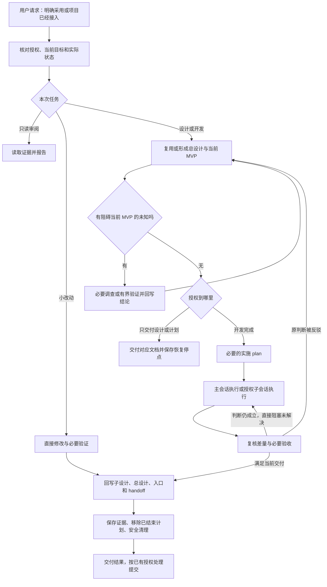

# fucxxx-codex-spec

一套用于 AI 辅助开发的 Codex Skill：从总设计选出当前 MVP，完成必要计划、实施和验收，再把实际结果回写设计，为下次会话留下可靠入口。

适用于前后端产品、Agent、内部工具和日常维护。尤其适合开发跨多个会话、需要子 Agent 协作，或者容易出现“修一个问题，顺手把整个架构做大”的项目。

**当前提供日常主入口，以及接入、设计、计划三个阶段 Skill；共用两份参考和四份模板。** 方法以 Markdown 为主，没有额外 CLI、调度器或强制执行 Hook。它能约束 Agent 应如何决策，但不能保证模型永不漏读、误判或偏离目标。

## 为什么使用

| 日常问题 | 本 Skill 的处理方式 | 预期收益 |
| --- | --- | --- |
| 需求只留在聊天里，换会话就丢失 | 项目内保存总设计、当前 MVP、活动计划和 handoff；恢复时核对实际代码与状态 | 减少重复交代背景和重复执行 |
| 总设计很大，迟迟看不到可用结果 | 只细化当前可验收 MVP，未来方向保留必要依赖 | 尽早验证核心能力，而非先完成所有架构 |
| 方案只处理表面症状，补丁越加越多 | 用背景、目的和限制定位问题，说明方案的作用点与可验证机制 | 优先解决关键缺口，区分止损与原因修复 |
| 发现相关缺陷后不断扩大范围 | 新阻塞必须对应用户确认的验收；连续出现关联问题时复核累计范围 | 避免把“有关联”自动升级成“本轮必须解决” |
| Agent 自己改大 design，又按新 plan 执行 | 用户确认的目标和决定才是范围依据，自行改文档不构成授权 | 防止文档看似一致，目标却已经被替换 |
| 子会话说完成，主区却不可用 | 主会话检查真实差量、证据与必要整合验收，再统一回写 | 区分局部通过、主区通过与用户目标达成 |
| 小修复也被要求填写大量文档 | 小改动直接修改和验证，只更新实际受影响记录 | 保持日常开发的轻量路径 |

以上是设计意图和有限样例支持的收益，不是节省时间、成本或提高成功率的量化承诺。实际验证范围见[验证记录](validation/skill-package-v0.4.md)。

## 快速使用

### 1. 先让 Agent 能读到 Skill

Skill 入口是 [`fucxxx-codex-spec/SKILL.md`](fucxxx-codex-spec/SKILL.md)，同目录的 `references/` 和 `assets/` 也需要保持可访问。

尚未安装时，可以在目标项目会话中明确指定本地包的真实路径：

```text
读取 /实际存放位置/fucxxx-codex-spec/SKILL.md，按它的方法处理本项目。
先检查已有规范与资料位置。只写当前 MVP 的设计和实施计划，给我审阅，先不要实施。
```

这只是通过文件入口使用方法，不代表已安装或已验证自动发现。正式安装由所用宿主的 Skill 管理方式完成；完整使用请提供 `fucxxx-codex-spec/`、`fucxxx-codex-spec-init/`、`fucxxx-codex-spec-design/`、`fucxxx-codex-spec-plan/` 四个目录。不要把整个仓库及验证样例当作 Skill 安装。这些目录无需固定相邻，但 Agent 必须能找到并读取实际入口。宿主已经发现该名称时，可以显式使用 `$fucxxx-codex-spec`。

### 2. 正式采用时接入项目 AGENTS.md

一次性明确接入范围，例如：

```text
本项目正式采用 fucxxx-codex-spec。
请核对现有 AGENTS.md、覆盖指令和已有设计资料，合并 Skill 的项目入口，
按需建立项目资料；保留原有约束，不修改全局配置。
这次只完成接入和当前 MVP 设计，不开始产品实施，不 commit 或 push。
```

主入口会按需转到 `fucxxx-codex-spec-init`；也可以直接指定该 Skill 的真实路径开展接入。临时“按此方法做”不会自动修改 AGENTS.md，重复接入只补已有材料的缺口，不追加另一套文档。接入完成后按原授权返回主入口，用户不必手动串联各阶段。

接入应把 Skill 的真实可读入口、项目资料根、读取和恢复要求合并进有效 AGENTS.md。使用[接入 Skill 中的片段](fucxxx-codex-spec-init/SKILL.md#项目接入)，替换占位路径后再采用；无需把整份 Skill 复制进去。

三者分工：**AGENTS.md 声明何时使用和从哪里读取；Skill 提供方法；项目文档保存当前目标和实际状态。** 正式采用后，相关开发请求即使没有再次点名，也应经该入口分流。接入验收要观察新会话是否实际读取并正确执行，不能仅检查文件存在。

### 3. 用自然语言说明本次交付终点

| 你可以这样说 | 应完成到哪里 |
| --- | --- |
| “先写总设计和当前 MVP，给我审阅。” | 交付设计及必要恢复记录；不默认生成所有计划或开始实施 |
| “按已确认的 MVP 写实施 plan，先不要改代码。” | 交付可执行计划，保留审阅停点 |
| “把当前 MVP 开发完成并验证，先不要 commit。” | 在授权和条件具备时连续完成必要设计、计划、实施、验收与收口 |
| “继续上次工作，先核对实际进度。” | 从 handoff 和现有资料恢复，核对差量，不重新初始化或重复派单 |
| “只读复核这次结果是否偏离目标。” | 读取证据并报告，不顺手修正文档或实现 |
| “修正这个文案／既定行为的小 Bug。” | 直接修改和验证，按需更新记录，不强制新建 MVP、plan 或子会话 |

如果希望委派，要明确授权和边界，例如：“使用内部子 Agent 验证和实施，主会话负责设计、复核及收口，不创建用户可见新聊天。”实际工具不可用时，Agent 应说明限制，不能假称已经派发或归档。

## 开发流程中何时介入

正式接入是按需的一次性能力，不是每个开发请求的前置。主入口按需读取设计能力（需求澄清、总设计与 MVP）和计划能力，执行与复核仍使用现有协作参考。已有设计不重新澄清，已有活动 plan 直接恢复执行，小修改跳过阶段能力；不是必须逐项调用的命令链。

触发后先判断当前请求和授权，不是每次都跑完整流程。已有有效资料直接复用；关键未知先调查或做有界验证；只有当前需要的文档才创建。



图中“回写”和“清理”只处理实际涉及的文件与资源，小任务不为了走完图而补建整套资料。未知验证达到投入边界、需要用户实质选择或权限不足时，暂停受影响部分并保存停点，不能无限循环。

| 介入时刻 | Skill 的作用 |
| --- | --- |
| 开始任务／换会话 | 找到有效入口、当前目标、活动计划和真实基线 |
| 形成设计／拆 MVP | 明确背景、用户结果和约束来源，选择有证据支持的作用点，再拆出可验收交付 |
| 写计划／交接 | 传递已定作用点与预期效果、接口、依赖、验收及写入归属，不重新定义设计 |
| 新增任务／发现反例 | 判断是否直接服务当前验收，防止目标和范围悄然变化 |
| 契约变化 | 先落实用户决定，更新受影响设计与 plan，再恢复对应执行 |
| 连续发现相关缺陷 | 区分本轮回归、直接障碍与相邻问题，核对累计范围 |
| 子会话返回／整合 | 检查实际成果，保留主区较新的设计，不用旧副本覆盖 |
| 达到完成条件 | 回补结论、保留证据、清理结束计划和安全资源，停止扩展 |

### 避免只处理症状

设计和 plan 不仅要回答“做什么”，还要说明“为什么这项改变能达成用户结果”。这些判断写入现有章节，不新增流程或必填表单：

- **背景**：观察到了什么，相关数据与调用经过哪些环节，哪些原因已有证据，哪些仍是假设。
- **目的**：用户实际需要什么结果；不提前把“增加重试”“增加 Agent”当成需求。
- **限制**：哪些是已确认要求或权限边界，哪些只是可调整的历史实现习惯。
- **作用点与验证**：改变哪一环、预期怎样起效，以及什么观察会支持或反驳判断。

例如，页面显示重复订单，目标应先明确为“不重复创建或展示订单”。需要查看提交、保存与读取链路，再判断是重复创建还是重复展示；直接在页面隐藏重复项，可能只掩盖了后端重复写入。若证据支持修改上游，应比较其效果与总代价；若上游不可控，临时止损也可以合理，但须说明剩余影响，且不能把止损冒充原因已消除。

无需无限寻找“最深根因”：证据足以选择可控、可验证的方案或达到投入边界时，就停止调查。更上游不自动代表更正确，小改动也不需要重新开展完整研究。实际结果反驳原判断时，回到相关设计检查来源、职责和接口，再调整计划；不能沿错误假设不断叠加补丁。具体方法见[设计与计划](fucxxx-codex-spec/references/design-and-plan.md)。

### 连续推进与暂停

“把功能做完”通常包含必要设计、计划、实施和验收。只要范围清楚、条件具备，就不因 design 写完、plan 写完或子会话返回而反复询问是否继续。

遇到以下情况，需要交付当前成果或暂停受影响操作：

- 到达用户指定的审阅／交付边界。
- 需要尚未决定的实质目标、契约、验收或成本变化。
- 关键契约仍不明确、必要权限／环境缺失，或达到约定投入边界。

普通纠错和必要调查继续在授权内处理；尚无新决定不能沿过期计划继续。新增锁、白名单、永久禁用、重试限制等机制，如果改变产品行为，需要核对其必要性与授权。“审查发现了问题”或“已经写进最新设计”都不能自动扩大任务。

## 文档与会话如何配合

下面是**使用该方法的业务项目**的资料布局，按需创建：

```text
<业务项目根>/
├── AGENTS.md                     # 稳定入口与读取要求
└── fucxxx-codex-spec/
    ├── design.md                 # 总目标、架构、MVP 关系和能力摘要
    ├── designs/                  # 各 MVP 的接口、验收和最终结论
    ├── plans/                    # 当前验证或实施安排及临时结果
    ├── evidence/                 # 必要证据，也可以复用已有测试与报告
    └── handoff.md                # 当前焦点、活动工作、阻塞和下一步
```

**本仓库里的同名目录是 Skill 包，不是业务项目状态目录。** 不要把项目进度写进已安装包。已有 OpenSpec、Spec Kit 或其他规格体系时，先确定复用位置与信息归属，不自动建立第二份权威设计。

主会话负责设计、关键取舍、复核、整合及权威回写；子会话执行明确任务并返回结果。共享工作目录时，各执行者有明确可写范围，同一 plan 指定维护者；主区总设计、子设计和 handoff 统一由主会话回写。独立工作区则核对真实基线和差量后整合。

收口顺序是：**复核与必要验收 → 回写设计和入口 → 更新 handoff → 保存必要判据与证据 → 移除已结束 plan → 安全清理 → 交付。** 计划仍有执行工作就保留。验证 plan 可以以失败或证据不足结束，但未决问题必须回到设计和 handoff，不能把删掉计划当成功。

commit、push、发布分别服从用户授权；明确“不提交”时保留本地。归档聊天、结束内部 Agent 和删除工作区是不同操作，宿主不支持时如实记录；工作区含唯一成果时不能清理。

## 与 OpenSpec、Spec Kit 的区别

对比日期：**2026-10-25**。下表依据当前官方文档与本仓库实现，比较默认组织方式和侧重点，不代表其他工具无法通过配置实现相似规则，也不是效果排名。

| 维度 | fucxxx-codex-spec | OpenSpec | GitHub Spec Kit |
| --- | --- | --- | --- |
| 主要组织单位 | 总设计下的当前 MVP 与会话推进状态 | 变更 change 与系统行为规格 | feature 的需求、技术计划与任务 |
| 典型材料 | 总／子 design、临时 plan、handoff | proposal、delta specs、design、tasks | constitution、spec、plan、tasks |
| 使用入口 | 日常主 Skill 路由到本地 init／design／plan，执行仍用协作参考 | CLI 初始化及对应 Agent 命令／Skills | Specify CLI 初始化及一组流程命令／Skills |
| 典型推进 | 明确目标 → 必要设计与计划 → 执行复核 → 回写与收口 | propose → apply → 规格同步与 archive，可先 explore | specify → plan → tasks → implement → converge |
| 本项目特别强调 | 用户授权依据、累计范围、主子写入归属、恢复停点 | 主规格与增量规格之间的变更表达和归档 | 需求、计划、任务之间的结构化衔接与一致性分析 |
| 结束材料 | 有效结论回写后移除结束 plan，保留长期设计与证据 | 同步主规格并归档 change 目录 | converge 对照材料检查实现，发现缺口时追加任务 |

OpenSpec 的主规格位于 `openspec/specs/`，单项变更集中在 `openspec/changes/`；增量规格描述新增、修改和移除，完成后同步并归档。它允许实施过程中回头调整材料，不能将其简单描述成固定瀑布流程。参见 [Getting Started](https://github.com/Fission-AI/OpenSpec/blob/main/docs/getting-started.md) 与 [官方 README](https://github.com/Fission-AI/OpenSpec/blob/main/README.md)。

Spec Kit 的 `clarify`、`checklist`、`analyze` 提供澄清和质量检查，部分步骤可选；`converge` 用于对照规格检查实现并追加剩余任务。它也提供精简材料的 Lean preset，并非所有任务都只能采用完整模板。参见 [Agentic SDD](https://github.github.com/spec-kit/reference/agentic-sdd.html) 与 [Lean preset](https://github.com/github/spec-kit/blob/main/presets/lean/README.md)。命令写法随宿主集成变化，上表表示概念阶段。

### 如何选择

以下是基于上述组织方式的使用建议：

- **主要困扰是 Agent 做着做着偏离 MVP、会话交接丢状态、复审不断扩大范围**：本 Skill 把这些决策规则集中在一个入口，便于按现有项目习惯采用。代价是没有专用 CLI 和机械门禁，需要 Agent 正确读取与执行。
- **需要系统行为规格、明确的增量变更和归档历史**：OpenSpec 的材料组织更直接。与本 Skill 相比，要接受并维护 change／specs 的组织方式。
- **希望通过现成命令逐步生成需求、技术计划、任务并检查一致性**：Spec Kit 的工具化步骤更完整。需要选择适合项目的检查与预设，避免把所有可选材料都变成每次任务的前置。

三者都需要正确的范围和验收判断。不能仅因为使用某个框架，就认定“自动不会跑偏”或“必然过度工程”。本项目的特别取舍是：即使 design 与 plan 同时被 Agent 更新，也要回到用户确认的目标判断是否获准扩张。

已有其他工具时，先复用它的权威文档，并明确哪些位置承担总目标、当前任务与恢复状态。不要机械运行两套流程；尤其不要直接套用本 Skill 的 plan 删除规则去删除另一工具需要保留或归档的 tasks／change。共用方式需要先明确，本仓库尚未验证与 OpenSpec、Spec Kit 的联合运行。

## 固定的设计与计划能力

设计能力补足真实场景澄清、方案比较和实施者视角检查；计划能力补足接口、依赖、任务判据和覆盖自查。它们使用主包已有模板与项目资料，不各建一套 design／plan／handoff。阶段完成后返回主入口，依据原请求继续或停在审阅点，不能通过切换能力扩大授权。

这两项能力依据本地 Superpowers **7.0.0 内容快照**适配，不要求安装外部 Superpowers。原始文件、哈希和[适配说明](vendor/superpowers-7.0.0/ADAPTATION.md)保存在 `vendor/`，仅供溯源，不能作为另一套流程加载；版本来自本地元数据，未核实上游 commit。安装只提供上述四个包，不安装 vendor 或验证样例。主包与两个改编能力随包保留原 MIT 许可。

保留需求澄清与可执行计划的方法，但不迁入固定提问轮次、逐任务 commit、固定五项风险、外部视觉服务器或执行账本。执行、调试、复核和收口的方法也已按以下顺序适配进现有协作参考，未搬入完整调度框架或脚本。升级需人工比较来源与行为验证，不自动跟随上游。

| 环节 | 具体方法 |
| --- | --- |
| 执行 plan | 对照权威设计检查接口；区分实现错误、计划错误与证据不足，普通纠错记录后继续 |
| 调试与返工 | 复现原失败、沿直接链路找首次偏差，用最小检查检验原因假设；保留有界调查和合理止损 |
| 主会话复核 | 检查完整差量和证据版本，发现须有位置、触发条件与影响；建议不自动扩成需求 |
| 收口与恢复 | 将重要纠错写回长期资料再移除结束计划；恢复时核对哪些证据仍有效，不盲目重跑或重派 |

## 当前验证与限制

已做隔离行为样例，覆盖连续推进、审阅停点、契约变更、共享目录归属、计划目标偏移、连续关联审查，以及两份文档同时被扩大后的纠正。保留了真实代码、测试输出与相关快照，见[验证记录](validation/skill-package-v0.4.md)。

2026-10-27 的独立样例进一步覆盖了问题作用点：上游可控时修复重复接收，上游不可修改且目标允许止损时仅修正列表展示。父会话复跑了原始失败及修复后测试；这些小型本地样例不证明复杂因果诊断或长任务稳定性。

接入拆分已用独立样例验证临时使用、正式接入、同会话重复接入、接入后继续设计并停在审阅点，以及主入口不可用时继续独立小任务。宿主自动发现、跨安装位置查找、跨会话重复接入及接入后完整开发仍未验证。具体输入、产物与限制见验证记录。

本地设计／计划能力已验证只设计、只计划和授权完整交付三个边界。首轮计划样例将自身当作子会话而把 handoff 交回主会话，另用明确模拟主会话的新上下文补测，生成了恢复入口。实测只提供本地四个包，未要求外部 Superpowers；读取隔离依靠任务约束，尚非宿主强制隔离或自动发现验证。

执行与复核方法另经一轮隔离样例验证：纠正违反用户契约的计划步骤、拒绝相邻功能扩张，完成实现并将纠错回写后删除结束计划；第二个独立上下文只读核验结果与恢复状态。具体差量、测试输出及未覆盖情境见验证记录。

这些是有限样例，不是长期稳定性证明。宿主自动发现／加载、真实上下文压缩和跨项目长期效果尚未完成验证。共享协作测试曾遇到子协调者没有派发工具，由上层代发后继续验证；不能据此宣称任意宿主都能自主调度和清理子会话。

## 仓库导航

| 文件 | 用途 |
| --- | --- |
| [设计 Skill](fucxxx-codex-spec-design/SKILL.md) | 澄清、方案选择、总设计与 MVP、实施者视角检查 |
| [计划 Skill](fucxxx-codex-spec-plan/SKILL.md) | 可交接任务、接口与验收自查 |
| [接入 Skill](fucxxx-codex-spec-init/SKILL.md) | 正式采用、AGENTS.md 合并、按需初始化与接入检查 |
| [SKILL.md](fucxxx-codex-spec/SKILL.md) | Agent 入口、分流与关键边界 |
| [设计与计划](fucxxx-codex-spec/references/design-and-plan.md) | MVP、未知验证、计划和范围依据 |
| [协作与收口](fucxxx-codex-spec/references/collaboration-and-closeout.md) | 项目接入、恢复、主子协作、复核和提交范围 |
| [总设计模板](fucxxx-codex-spec/assets/master-design.template.md) | 整体目标与 MVP 关系 |
| [MVP 模板](fucxxx-codex-spec/assets/mvp-design.template.md) | 当前交付、接口、验收及结论 |
| [Plan 模板](fucxxx-codex-spec/assets/plan.template.md) | 验证／实施安排和执行结果 |
| [Handoff 模板](fucxxx-codex-spec/assets/handoff.template.md) | 当前状态与恢复入口 |
| [v0.4 设计草稿](fucxxx-codex-spec-skill-design-draft.md) | 历史设计依据；后续规则以当前 Skill 包为准 |
| [验证记录](validation/skill-package-v0.4.md) | 各版本的样例结果、证据和未验证范围 |

`validation/` 中的 AGENTS.md、代码和项目文档是测试样例，不是本仓库的开发入口或需要安装的组成部分。
